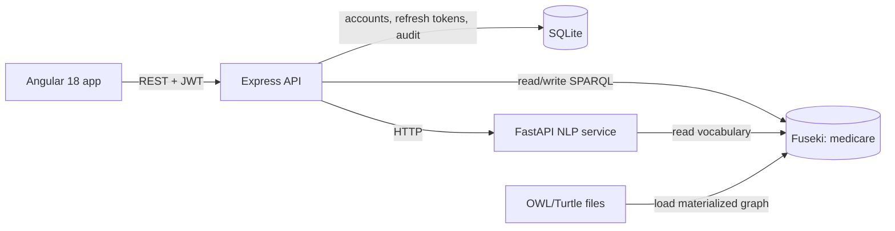

# MedicCare

MedicCare is a semantic healthcare demo with an Angular front office and staff console, an Express API, Apache Jena Fuseki for clinical facts, SQLite for accounts and audit events, and a local Python NLP service that translates English and French questions into SPARQL.

## Architecture



Ontology individuals and clinical relationships live in Fuseki. Account credentials, refresh tokens and audit entries live in SQLite. The API's ontology writer validates writes and materializes superclass types, inverse links and derived relationships because the configured Fuseki dataset runs without a reasoner.

## Prerequisites

- Node.js 20 or newer and npm.
- Python 3.11 (the NLP requirements are pinned for this environment).
- Docker with Compose, or a local Apache Jena Fuseki server.
- The English spaCy models `en_core_web_md` and `fr_core_news_md`.

## Setup

From the repository root, install the two JavaScript projects and prepare the NLP virtual environment:

```powershell
npm --prefix backend ci
npm --prefix frontend ci
py -3.11 -m venv backend/nlp-service/.venv
backend/nlp-service/.venv/Scripts/python.exe -m pip install -r backend/nlp-service/requirements.txt
backend/nlp-service/.venv/Scripts/python.exe -m spacy download en_core_web_md
backend/nlp-service/.venv/Scripts/python.exe -m spacy download fr_core_news_md
Copy-Item backend/.env.example backend/.env
```

Set a private `JWT_SECRET`, `FUSEKI_PASSWORD`, and `SEED_DEMO_PASSWORD` in `backend/.env` before using the demo outside a disposable local environment. Do not commit that file. Optional NLP embeddings are disabled by default; enabling them requires installing `sentence-transformers` in the NLP virtual environment and setting `USE_EMBEDDINGS=true`.

Start Fuseki and load the provided materialized ontology into the configured `FUSEKI_DATASET`:

```powershell
npm run infra
npm run ontology
npm run seed
```

`npm run ontology` clears and reloads the selected dataset. Point it only at a dataset you intend to replace. The seed command creates SQLite demo accounts; it checks that linked patient and doctor individuals already exist in Fuseki.

For a local Fuseki installation instead of Docker, start it with updates enabled and an in-memory `/medicare` dataset, for example `fuseki-server --update --mem /medicare`, then set the Fuseki connection values in `backend/.env` to match.

Run each service in its own terminal:

```powershell
npm run nlp
npm run api
npm run web
```

The app is served at `http://localhost:4300`, the API at `http://localhost:4000/api`, Swagger UI at `http://localhost:4000/api/docs`, and the NLP service at `http://localhost:8100`. `npm run build`, `npm run test:api`, `npm run test:nlp`, `npm run test:web`, and `npm run lint` run the project checks.

## Environment variables

The complete backend example is [backend/.env.example](backend/.env.example). The main settings are:

| Variable | Purpose |
| --- | --- |
| `PORT`, `CORS_ORIGINS` | API listener and allowed browser origins |
| `FUSEKI_BASE_URL`, `FUSEKI_DATASET`, `FUSEKI_USER`, `FUSEKI_PASSWORD` | Fuseki connection for the API |
| `JWT_SECRET`, `JWT_ACCESS_TTL_MINUTES`, `JWT_REFRESH_TTL_DAYS` | Signed sessions and token lifetime |
| `SQLITE_FILE` | SQLite account and audit database path |
| `NLP_SERVICE_URL`, `NLP_TIMEOUT_MS` | API-to-NLP connection |
| `SEED_DEMO_PASSWORD` | Password assigned to newly created demo accounts; it is never printed by the seed script |
| `USE_EMBEDDINGS`, `EMBEDDING_MODEL`, `NLP_MIN_CONFIDENCE` | Optional NLP retrieval settings and confidence threshold |

The Compose service reads `FUSEKI_ADMIN_PASSWORD`; use the same value as `FUSEKI_PASSWORD` in the backend configuration.

## Demo accounts

`npm run seed` creates these email addresses and roles. Use the value you configured for `SEED_DEMO_PASSWORD`; no password is embedded in this README.

| Email | Role | Demonstrates |
| --- | --- | --- |
| `admin@medicare.tn` | ADMIN | Back office, user/audit management, console and ontology tools |
| `nour.elamri@medicare.tn` | ADMIN | English interface |
| `reception@medicare.tn` | RECEPTIONIST | Patient registration and appointment desk |
| `salma.benali@medicare.tn` | DOCTOR | Doctor workspace and scoped patient records |
| `hatem.trabelsi@medicare.tn` | DOCTOR | Doctor row-level scoping comparison |
| `ahmed@medicare.tn` | PATIENT | Patient portal and own-record scoping |
| `sara@medicare.tn` | PATIENT | Second patient account for scope comparison |

The seed command leaves existing accounts untouched. If an account already exists, changing `SEED_DEMO_PASSWORD` does not change its password; use the profile password-change flow or recreate the local SQLite database only when you are comfortable losing local accounts and audit history.

## Role permissions

| Capability | ADMIN | DOCTOR | RECEPTIONIST | PATIENT |
| --- | --- | --- | --- | --- |
| Clinical entity records | Full CRUD | Own patients, appointments and tests; knowledge is read-only | Patient identity and appointments; directory is read-only | Own record and appointments; tests read-only |
| Patient scope | All patients | Patients followed by the signed-in doctor | Registration and scheduling | Signed-in patient's own records only |
| Users and audit log | Manage and review | — | — | — |
| SPARQL console | Run queries | — | — | — |
| NLP assistant | Full assistant and query handoff | Scoped to own patients | Not available | Limited to own patient data |
| Ontology explorer | Full explorer | Read-only | — | — |
| Consistency and ontology statistics | Read; repair is an audited admin action | — | — | — |

Every API request is checked independently of the Angular route guards. The server also restricts doctor and patient query results to the linked clinical records.

## API overview

The interactive OpenAPI reference is served at `/api/docs`; the raw document is at `/api/openapi.json`. Main route groups include `/api/auth`, `/api/users`, `/api/audit`, the ten entity collections (`/api/patients`, `/api/doctors`, `/api/diseases`, `/api/symptoms`, `/api/treatments`, `/api/medications`, `/api/tests`, `/api/appointments`, `/api/hospitals`, `/api/departments`), `/api/search`, `/api/dashboard`, `/api/ontology`, `/api/consistency`, `/api/nlp`, and `/api/console`.

## Troubleshooting

- **Fuseki is unavailable:** check that Docker is running, then inspect `docker compose logs fuseki`. Verify the base URL, dataset name and matching credentials in `backend/.env`.
- **The API reports an empty graph:** run `npm run ontology` against the intended dataset, then run `npm run seed` to create the account rows.
- **A linked demo account cannot be seeded:** load the ontology first; the seed script verifies its linked individual rather than inventing one.
- **NLP model load fails:** install both named spaCy models into `backend/nlp-service/.venv`, not a system Python environment.
- **Forgot password:** the endpoint deliberately returns the same response for known and unknown addresses. Mail delivery is not configured; see the API docs.
- **Integration tests:** they require the separate `medicare_test` Fuseki dataset. The test setup checks the dataset suffix before clearing it.

## Validation notes

The NLP routing suite can run with Fuseki offline using the bundled Turtle vocabulary. On 2026-10-29, the Fuseki-backed evaluation passed 137/137 cases across 48 intents (100.0%), and the NLP pytest suite passed 292 tests. See [docs/nlp-evaluation.md](docs/nlp-evaluation.md) for per-intent results and limits.

The Playwright end-to-end suite passed both browser flows against the isolated `medicare_test` graph on 2026-10-29.

## Browser end-to-end checks

The Playwright flows require a separate disposable setup. In `backend/.env`, point `FUSEKI_DATASET` at `medicare_test` and `SQLITE_FILE` at a disposable SQLite file; set a private `SEED_DEMO_PASSWORD`. Start Fuseki, load the ontology and seed the accounts with those settings, then start the NLP service, API and web app. The Playwright config uses installed Google Chrome. In the test terminal, set `E2E_DEMO_PASSWORD` to the same private password and run `npm run test:e2e`; set `E2E_API_URL` and `E2E_BASE_URL` if the isolated API or web app uses different ports. Each test checks `/api/status` and stops before any write unless the API reports a dataset ending in `_test`.
